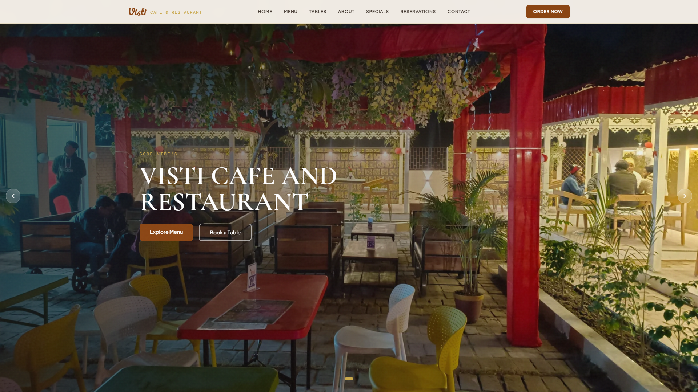
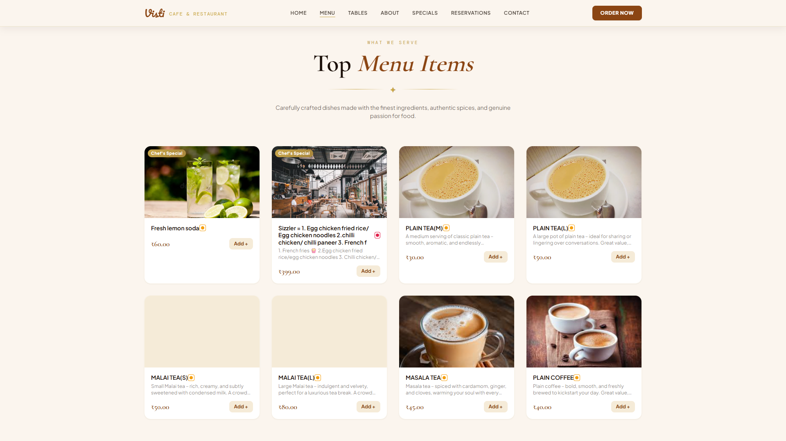
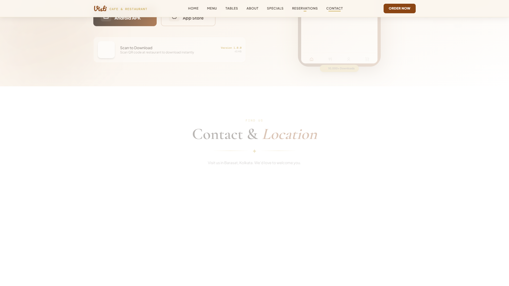
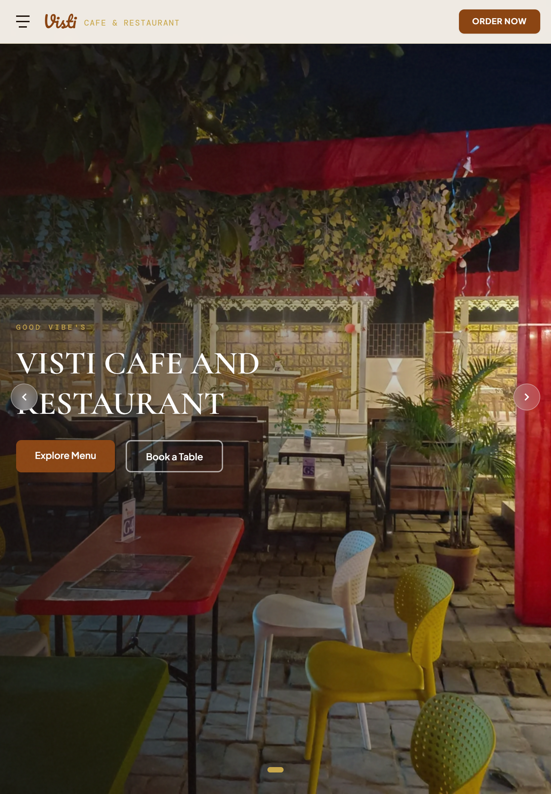
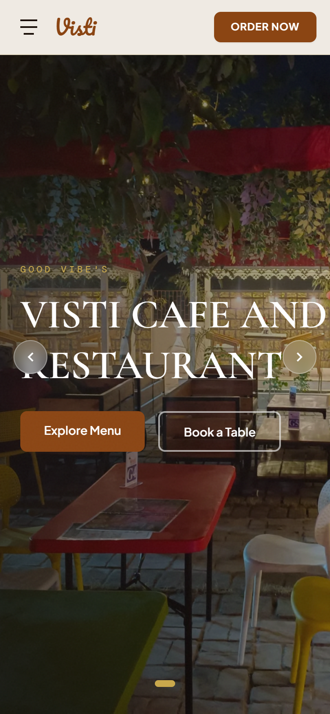
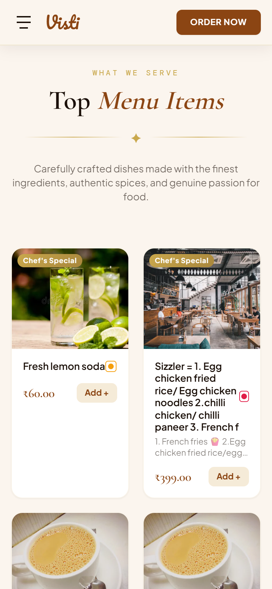

# Visti Cafe & Restaurant — Full-Stack POS, Direct Online Ordering & RMS

[](https://visticafeandrestaurant.com)
[](https://visticafeandrestaurant.com)
[](https://visticafeandrestaurant.com)

> **Live Production URL:** [https://visticafeandrestaurant.com](https://visticafeandrestaurant.com)  
> **Notice:** *The source code for this enterprise production application is confidential and proprietary. This public showcase repository provides an in-depth architectural overview, engineering case study, and technical feature highlights.*

---

## 🚀 Executive Summary

**Visti Cafe & Restaurant** is a high-performance, full-stack Restaurant Management System (RMS), Multi-Channel Point of Sale (POS), and Direct Digital Ordering Platform built to power daily restaurant operations with zero reliance on third-party aggregators and 0% commission fees.

Engineered from the ground up to solve the real-world friction of busy restaurant floors, the platform coordinates customer ordering, table occupancy reservations, kitchen display units (KDS), waiter dispatching, automated attendance, payroll accounting, and a parallel 3-printer hardware dispatching engine.

---

## 📸 Platform Interface & Multi-Device Showcase

The platform features an adaptive, zero-latency responsive interface engineered for high-concurrency ordering across desktop workstations, waiter floor tablets, and guest smartphones.

### 🖥️ Desktop & Laptop Experience (1920×1080)

| 🌟 Hero & Direct Ordering Experience | 🍽️ Interactive Menu & Category Navigation |
| :---: | :---: |
|  |  |

| 🪑 Real-Time Table Reservation & Floor Booking |
| :---: |
|  |

---

### 📱 Tablet & Mobile Responsive Experience

| 📟 Tablet Floor View (820×1180) | 📲 Mobile Guest Home (390×844) | 🛒 Mobile Ordering & Menu (390×844) |
| :---: | :---: | :---: |
|  |  |  |

---

## 🏛️ System Architecture

```text
               ┌────────────────────────────────────────────────────────┐
               │           CUSTOMERS & GUESTS (WEB / PWA)               │
               │   • Menu & Food Ordering    • Table Reservations       │
               │   • Live Bill Tracking      • Direct Checkout          │
               └───────────────────────────┬────────────────────────────┘
                                           │ HTTPS (REST / WebSockets)
                                           ▼
┌───────────────────────────────────────────────────────────────────────────────────┐
│                    VISTI CLOUD CORE PLATFORM (PHP 8.2 / LARAVEL)                   │
├─────────────────────────┬───────────────────────────────┬─────────────────────────┤
│    BILLING & POS        │      KITCHEN ENGINE (KDS)     │    PAYROLL & HRMS       │
│  • Split Billing        │    • Table FIFO Dispatch      │  • Shift Tracking       │
│  • Taxes / Discounts    │    • Status Synchronization   │  • Joining-Date Cycles  │
│  • Customer CRM Ledger  │    • Item-Level Cancellation  │  • 10-Day Hold Engine   │
└────────────┬────────────┴───────────────┬───────────────┴────────────┬────────────┘
             │                            │                            │
             ▼                            ▼                            ▼
┌─────────────────────────┐  ┌─────────────────────────┐  ┌─────────────────────────┐
│     BILL PRINTER        │  │      KKOT PRINTER       │  │      BKOT PRINTER       │
│  (Cashier Desk / 80mm)  │  │  (Main Kitchen / 80mm)  │  │   (Beverage Bar / 80mm) │
│  • Customer Receipt     │  │  • Hot Kitchen Orders   │  │  • Mocktails & Coffee   │
│  • GST & Verification   │  │  • Modifiers & Notes    │  │  • Barista Ticket       │
└─────────────────────────┘  └─────────────────────────┘  └─────────────────────────┘
             ▲                            ▲                            ▲
             └────────────────────────────┼────────────────────────────┘
                                          │ ESC/POS Native Protocol
                             ┌────────────┴────────────┐
                             │  FLUTTER HARDWARE BRIDGE│
                             │  • Bluetooth            │
                             │  • Thermal LAN / IP     │
                             │  • Native USB Direct    │
                             └─────────────────────────┘
```

---

## 🌟 Core Technical Highlights

### 1. Commission-Free Direct Online Ordering & Real-Time Reservations
* **Direct-to-Kitchen Workflow:** Customers order directly from their smartphones via responsive web app or QR code at their table without downloading third-party marketplace apps.
* **Smart Table Occupancy Management:** Interactive floor plan visualizes real-time table statuses (Available, Seated, Billed, Cleaning), preventing double booking and optimizing floor turn times.
* **Customer Self-Service:** Real-time bill inspection, dynamic add-on ordering, and reservation confirmations via automated SMS and WhatsApp integrations.

### 2. Parallel 3-Printer Hardware Dispatch Engine
* **Concurrent Triple Dispatch:** When an order is placed or settled, the system splits items and routes print jobs simultaneously without blocking the UI thread:
  1. **KKOT (Kitchen Order Ticket):** Dispatches cooked items to the main kitchen line with cooking instructions.
  2. **BKOT (Beverage Kitchen Order Ticket):** Routes drinks, coffees, and desserts directly to the beverage counter.
  3. **BILL Ticket:** Produces tax receipts at the cashier station with QR payment integration.
* **Flutter Native Android Shell:** Acts as an edge gateway running on local restaurant tablets, establishing fail-safe connections to ESC/POS thermal printers via **Bluetooth**, **LAN (TCP/IP socket)**, and **USB OTG**.

### 3. Zero-Click Mobile Waiter Ordering & Kitchen Controls
* **Instant Floor Taking:** Waiters carry pocket devices to take orders tableside in seconds, featuring rapid item filtering, portion toggling (Half / Full), and special instructions.
* **Grouping by Service Type:** Automatically segments items into Dine-In (D) and Takeaway (T) for differentiated packaging and kitchen timing.
* **Item-Level Auditing & Cancellation Controls:** Secure permission gates ensure canceled items require owner/manager authorization with mandatory audit reasons to prevent floor pilferage.

### 4. Rule-Based Customer Loyalty CRM & Inventory Tracking
* **Automated Customer Profiles:** Phone-number-based CRM tracks lifetime spend, dining frequency, favorite dishes, and dining preferences.
* **Dynamic Reward Engine:** Points accrued per bill can be redeemed on future visits, driving recurring guest retention.
* **Recipe-Level Stock Depletion:** Menu items map to raw ingredient inventories, triggering automatic stock adjustments upon checkout with low-threshold warning alerts.

### 5. Automated Joining-Date Payroll & Staff Ledger Engine
* **Dynamic Cycle Anchoring:** Calculates individualized 28-day / 30-day salary periods anchored directly to each employee's `joining_date`, rather than arbitrary calendar months.
* **10-Day Hold Policy:** Automatically enforces security hold rules, unlocking cash due for payout 10 days post-cycle.
* **FIFO Multi-Cycle Settlement:** Intelligently allocates bulk salary disbursements against previous outstanding cycle dues before attributing remainder sums to the active period, displaying clear audit tags like `[total 16,000 given]`.

---

## 🛠️ Technology Stack

| Layer | Technology | Purpose |
|---|---|---|
| **Backend Core** | PHP 8.2+ / Laravel 11 | High-throughput business logic, REST APIs & security |
| **Web Server** | LiteSpeed Enterprise (LSCache) | High concurrency, sub-second responses, low TTFB |
| **Database** | MySQL 8.0 / MariaDB | Relational persistence, indexed queries, transactional integrity |
| **Frontend UI** | Blade, Tailwind CSS, Alpine.js | Responsive, zero-latency tableside POS experience |
| **Hardware Client** | Flutter / Dart (Native Shell) | ESC/POS Bluetooth, LAN, and USB thermal printer communication |
| **CI/CD** | GitHub Actions | Automated branch management, linting, and public documentation sync |

---

## 🔒 Intellectual Property & Contact

The proprietary source code for this enterprise deployment is maintained in private repositories under commercial license. For technical inquiries, custom enterprise POS development, or solution demonstrations, please contact:

* **Platform:** [https://visticafeandrestaurant.com](https://visticafeandrestaurant.com)
* **Organization:** RG Creators
* **Developer Contact:** `rgcreatorsofficial@gmail.com` ([rgcreatorsofficial@gmail.com](mailto:rgcreatorsofficial@gmail.com))

---
*(c) 2026 Visti Cafe & Restaurant. All rights reserved.*
